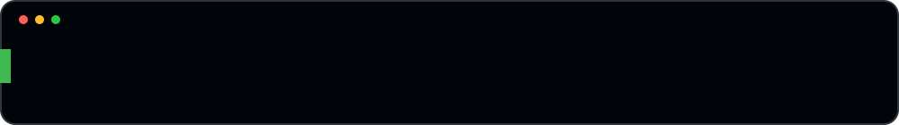

  

  

## About

Hi, I'm Pushkar. I'm in my final year of Computer Science and I like building things from start to finish, from the first design to getting it deployed.

Most of my work so far is a mix of full-stack web apps, cloud (AWS), and machine learning. Lately I've been building a desktop trading terminal for Indian equities and a serverless document storage platform with extra login security. Outside of projects I practice data structures and algorithms on LeetCode and CodeChef.

**Right now I'm working on:** Thrice Nomisma (trading terminal) and getting better at contest problems.
**Looking for:** internships and projects where I can build real things.

## Tech stack

  

Also: Pandas, NumPy, LangChain, Electron, Three.js, DynamoDB, REST and WebSockets.

## Competitive programming

&nbsp;

[LeetCode](https://leetcode.com/u/pushkar-kumar10/) · [CodeChef](https://www.codechef.com/users/pushkar_kumarr)

> Fellow competitive programmers: let's solve, compete and climb the ratings together! 🧠⚡🚀
